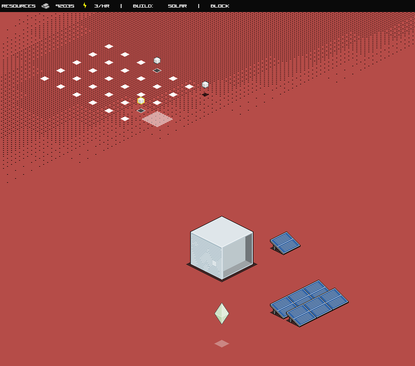

# Mind your own Empire

A single-player, procedurally generated isometric RTS for the browser.

You are a Mind, landed on a new planet, preparing it for the coming of humans. You command and upgrade your minions and buildings. They mine resources, fight off the original inhabitants and other interested races, and build for you.

The game is an early prototype. You can explore, select units, walk them around, mine iron and place buildings.



## Playing

| Input | Action |
| --- | --- |
| Left click / drag | Select units, or place the chosen building on every free tile in the drag area (red tiles are blocked) |
| Right click / drag | Order the selection: mine the iron in the area, or walk to the pointer |
| Shift + right click | Queue the order after the current ones instead of replacing them |
| W A S D / arrow keys | Scroll (hold Shift to scroll faster) |
| Shift while placing | Keep the building selected to place more |
| C / Shift + C | Cancel the next order / all orders of the selection |
| Esc | Leave build mode and clear the selection |
| P | Pause |

The seed on the start screen picks the map, so the same seed always gives the same world.

## Development

You need Node.js 22.12 or newer (`.nvmrc` pins the version CI uses).

```sh
npm install
npm run dev        # dev server with hot reload at http://localhost:5173
npm run build      # type-check and build to dist/
npm run preview    # serve the production build
```

Checks, all of which run in CI:

```sh
npm run lint       # Biome lint + format check (npm run format to fix)
npm run typecheck  # TypeScript
npm test           # Vitest unit tests
npm run test:e2e   # Playwright browser tests against the production build
```

Run `npx playwright install chromium` once before the first `npm run test:e2e`.

### Stack

- **TypeScript** and **Vite**, built as two pages: `index.html` (start menu) and `game.html`.
- **PixiJS** renders the world, using WebGPU where the browser supports it and WebGL otherwise.
- **simplex-noise** with an **Alea** seeded random generator for terrain and iron.
- **Biome** for linting and formatting, **Vitest** for unit tests and **Playwright** for browser tests.

### Layout

```
src/
  game/
    main.ts         entry point: wires state, renderer, input and HUD; fixed 60 Hz simulation loop
    state.ts        game state and player commands (select, build, order, scroll)
    units.ts        units and buildings: footprints, path following, unit avoidance, gathering
    pathfinding.ts  A* route planning, path smoothing, group destination spreading
    world.ts        chunked world: terrain, iron and fog of war
    terrain.ts      noise-based terrain and iron generation, sand transition tiles
    coords.ts       isometric grid <-> world maths
    renderer.ts     PixiJS rendering
    input.ts        mouse and keyboard handling
    hud.ts          resource bar, build buttons, messages, pause dialog
    definitions.ts  typed access to the JSON data below
  data/             object and resource definitions (JSON)
  assets/           tilesets (PNG + JSON), icons, fonts
  styles/           CSS
tests/              unit tests
e2e/                browser tests
art/                source artwork (GIMP .xcf) and unused images, not shipped
docs/               design notes
```

### Pathfinding

Movement follows the approach classic RTS games such as Age of Empires use, split into two layers:

- **Long-range planning** (`pathfinding.ts`): A* over the tile grid. Acid and the tiles under buildings are impassable, and units never cut diagonally between two blocked tiles. Each step costs its real on-screen length, because isometric tiles aren't square. The route is then smoothed into straight legs. If the target can't be reached, the unit walks to the nearest tile it can reach. The search has a node budget, and at most a few new routes are planned per tick, so a large group order can't stall a frame.
- **Short-range avoidance** (`units.ts`): units keep a little personal space. A unit that runs into another one first swerves, always to its own right so two units meeting head-on pass each other. If it can't swerve, it waits briefly for a moving unit to clear. After that it re-plans its route around the blocker, and it gives up after a few attempts. If the destination itself is taken by a unit that isn't moving, getting close counts as arriving.
- **Groups**: every unit in a move order gets its own spot around the clicked point, and spots go to the nearest units first, so groups fan out instead of piling up. Gatherers each start on a different iron tile.
- **Buildings**: buildings occupy the tiles under their base. They can't be placed on unexplored, blocked or acid tiles, and units standing on a new building's footprint are moved out of the way.

The simulation in `state.ts`, `units.ts`, `pathfinding.ts`, `world.ts`, `terrain.ts` and `coords.ts` has no DOM or rendering dependencies, so it can be unit-tested in Node.

## Deployment

Every push to `master` builds the game and publishes it to GitHub Pages using `.github/workflows/deploy.yml`. Pages has to be enabled once under **Settings → Pages → Source: GitHub Actions**.

## License

MIT. See [LICENSE](LICENSE).
