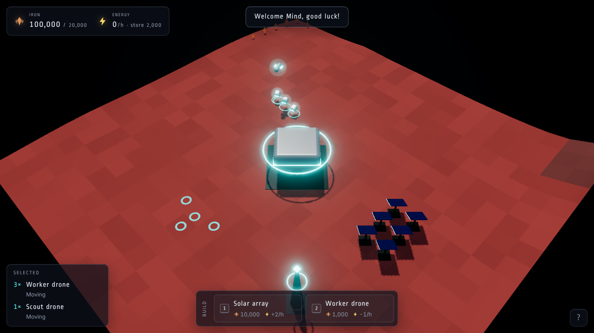

# Mind your own Empire

A single-player, procedurally generated 3D RTS for the browser, inspired by Iain M. Banks' Culture novels.

The Idiran war. A Culture Mind called *Only Visiting* comes down hard on a world whose builders Sublimed long ago, leaving their machines to keep the place tidy. The caretakers would like it to leave, the Idirans would like it destroyed, and the Mind would mostly like its sensors back. The setting and story are being worked out in [docs/World.md](docs/World.md) (contains spoilers).

The game is an early prototype with the first two campaign missions playable:

1. **Arrived.** Learn the ropes: mine iron, carry it home, build drones, keep the power up, raise a sensor spire.
2. **The Staff.** Meet the Custody, the caretaker machines that dismantle anything left unattended, and keep your base standing while they patrol it.

There's also **Survey** mode: free play on any seed, with no objectives.



It started in 2014 as a 2D isometric game ([2015 screenshot](docs/screenshot-2015-01-03.png)); the old sprites are kept in `art/legacy-2d/`.

## Playing

| Input | Action |
| --- | --- |
| Left click / drag | Select units, or place the chosen building on every free tile in the drag area (red tiles are blocked) |
| Right click / drag | Order the selection: mine the iron in the area, or walk to the pointer |
| Shift + right click | Queue the order after the current ones instead of replacing them |
| W A S D / arrow keys | Pan the camera (hold Shift to pan faster) |
| Q / E, or middle-mouse drag | Rotate the camera |
| Mouse wheel | Zoom (zoom right in and the camera tilts up to look out across the land) |
| 1 / 2 / 3 | Pick a worker drone, collector or sensor spire to place (press again to put it away) |
| Shift while placing | Keep the building selected to place more |
| . (full stop) | Select idle worker drones and centre on them |
| C / Shift + C | Cancel the next order / all orders of the selection |
| Esc | Leave build mode and clear the selection |
| P | Pause |
| M | Sound on / off (wind and distant chimes start on your first click or key press) |

In Survey mode, the seed on the start screen picks the map, so the same seed always gives the same world.

### How it plays

- **Iron** is mined by worker drones. Each drone carries 10 at a time back to the Mind, which stores up to 1,000.
- **Power** comes from the Mind's reactor and from collectors, and every drone and spire uses some. If it drops below zero, every drone works at half speed.
- **The Custody's wardens** patrol and dismantle any building that has no drone nearby and isn't covered by a sensor spire. A building they're eyeing gets an amber ring, which is your warning to send someone over.

## Development

You need Node.js 22.12 or newer (`.nvmrc` pins the version CI uses).

```sh
npm install
npm run dev        # dev server with hot reload at http://localhost:5173
npm run build      # type-check and build to dist/
npm run preview    # serve the production build
```

Add `?debug` to the game URL to expose the running game as `window.mindGame` in the console.

Checks, all of which run in CI:

```sh
npm run lint       # Biome lint + format check (npm run format to fix)
npm run typecheck  # TypeScript
npm test           # Vitest unit tests
npm run test:e2e   # Playwright browser tests against the production build
```

Run `npx playwright install chromium` once before the first `npm run test:e2e`.

### Stack

- **TypeScript** and **Vite**, built as two pages: `index.html` (start menu) and `game.html`.
- **Three.js** renders the world in 3D with `WebGPURenderer`: WebGPU where the browser supports it, WebGL 2 otherwise. Shadows and bloom are included, and all models are built in code (`models.ts`), with no asset files.
- **simplex-noise** with an **Alea** seeded random generator for terrain and iron.
- The interface is plain HTML and CSS overlaid on the 3D view: translucent glass panels with luminous edges, accented in the player's colour. Icons are inline SVG.
- **Biome** for linting and formatting, **Vitest** for unit tests and **Playwright** for browser tests.

### Layout

```
src/
  game/
    main.ts         entry point: wires state, renderer, input and HUD; fixed 60 Hz simulation loop
    state.ts        game state, economy and player commands (select, build, order, camera)
    missions.ts     the campaign: briefings, objectives, scripted events, the Mind's lines
    custody.ts      the caretaker machines and their rules
    units.ts        units and buildings: footprints, path following, unit avoidance, gathering
    pathfinding.ts  A* route planning, path smoothing, group destination spreading
    world.ts        chunked world: ground, heights, cliffs, iron and fog of war
    terrain.ts      noise-based terrain: ground types, heights and iron
    coords.ts       tile and ground-plane maths
    renderer.ts     Three.js scene: terrain meshes, units, previews, camera, picking
    scenery.ts      flora, rocks, ruins and crash debris: placement and instanced drawing
    atmosphere.ts   sky, sun, the gas giant and drifting spores
    fauna.ts        wildlife behaviour: grazing herds, circling flocks, the longshank
    creatures.ts    wildlife models and animation
    audio.ts        the synthesised ambient soundscape
    models.ts       procedural 3D models: the Mind, drones, towers, solar arrays, iron
    input.ts        mouse and keyboard handling, picking through the 3D view
    hud.ts          resources, build bar, selection panel, messages, pause dialog
    definitions.ts  typed access to the JSON data below
  data/             object and resource definitions (JSON)
  assets/           fonts
  styles/           CSS: shared design tokens and glass panels, menu and in-game HUD
tests/              unit tests
e2e/                browser tests
art/                source artwork (GIMP .xcf), the old 2D sprites and unused images, not shipped
docs/               design notes
```

### The 3D world

- **Units:** one tile is one world unit, horizontally and vertically. The game logic works on the ground plane, and height is only added when placing things in 3D.
- **Terrain:** heights come from noise. Rolling hills, sharp ridges whose steepest parts become cliffs, and hollows where acid pools. The ground around the starting base is flattened so you can build there.
- **Cliffs:** a step between neighbouring tiles that climbs more than `MAX_CLIMB` can't be walked. Climbing gentler slopes costs extra, so routes go around hills when that isn't much further.
- **Buildings:** they need fairly level ground, so placement is refused if the footprint varies in height by more than `MAX_BUILD_SLOPE`.
- **Drones and flying:** worker drones hover close to the ground and follow paths. The scout flies higher and goes straight over acid, cliffs and buildings. Flying and ground units don't block each other.
- **Fog:** unexplored ground isn't drawn (it fades into the haze), and explored ground nobody can currently see is dimmed.
- **Scenery:** rust-grass, copperleaf shrubs, lantern stalks, parasol trees, boulders, Tessilend ruins and the wreckage of the Mind's landing. It's placed per tile from a hash of the tile's position, so a world always looks the same. It's purely visual: it never blocks anything, and it disappears under buildings. Each kind is one instanced mesh, and plants sway in the wind in the vertex shader.
- **Wildlife:** herds of six-legged trundlers graze and bolt from drones, flocks of kites circle over the groves, and now and then a longshank, an animal the size of a house, strides across the far country. Like the scenery, it has no effect on the game. Small animals are only seen where the player has eyes, but a longshank is tall enough to be seen over any explored ground. Only animals near the camera are simulated, and any that wander off are moved back somewhere out of sight.
- **Atmosphere:** late-afternoon light, with a low sun for long shadows and haze in the distance. The sky has a ringed gas giant on the horizon, glowing spores drift past, and acid pools shimmer. Zooming in lowers the camera towards the horizon.

### Pathfinding

Movement follows the approach classic RTS games such as Age of Empires use, split into two layers:

- **Long-range planning** (`pathfinding.ts`): A* over the tile grid, using only what the player knows. Explored acid, explored cliffs and the tiles under buildings are impassable. Unexplored ground is assumed walkable, so routes don't give away what's hidden in the fog. When a unit uncovers acid or a cliff, or a new building cuts across its remaining route, it re-plans. Units never cut diagonally between two blocked tiles. The search stays within a box around where the order was given and the target, so an unreachable target can't send units roaming the map. They get as close as they can and stop. The route is then smoothed into straight legs. If the target can't be reached, the unit walks to the nearest tile it can reach. The search has a node budget, and at most a few new routes are planned per tick, so a large group order can't stall a frame.
- **Short-range avoidance** (`units.ts`): units keep a little personal space. A unit that runs into another one first swerves, always to its own right so two units meeting head-on pass each other. If it can't swerve, it waits briefly for a moving unit to clear. After that it re-plans its route around the blocker, and it gives up after a few attempts. If the destination itself is taken by a unit that isn't moving, getting close counts as arriving.
- **Groups**: every unit in a move order gets its own spot around the clicked point, and spots go to the nearest units first, so groups fan out instead of piling up. Gatherers each start on a different iron tile.
- **Buildings**: buildings occupy the tiles under their base. They can't be placed on unexplored, blocked or acid tiles, and units standing on a new building's footprint are moved out of the way.

The simulation in `state.ts`, `missions.ts`, `custody.ts`, `units.ts`, `pathfinding.ts`, `world.ts`, `terrain.ts` and `coords.ts` has no DOM or rendering dependencies, so it can be unit-tested in Node.

## Deployment

Every push to `master` builds the game and publishes it to GitHub Pages using `.github/workflows/deploy.yml`. Pages has to be enabled once under **Settings → Pages → Source: GitHub Actions**.

## License

MIT. See [LICENSE](LICENSE).
